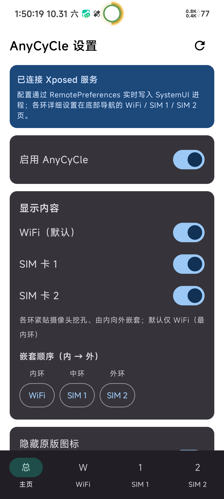

# AnyCyCle

**AnyCyCle** 是一个基于 libxposed API 102 的 LSPosed 模块：它把状态栏信号（SIM1 / SIM2 / WiFi 档位 0–4）画成嵌套的环形指示器（多环套环），并按 HyperCeiler 的方式隐藏状态栏对应的原版图标。

- 应用名：AnyCyCle
- 包名：`io.github.z2549.anycycle`
- minSdk 35 / targetSdk 36 / compileSdk 36
- AGP 8.13.1 + Gradle 8.13 + Kotlin 2.2.10
- 许可证：AGPL-3.0-only

## 功能

- **多环嵌套显示**：在状态栏绘制嵌套环形指示器，WiFi、SIM1、SIM2 各占一环，直观呈现 0–4 档信号强度。
- **逐环颜色与粗细**：每一环的颜色、粗细均可独立配置。
- **数值级档位变色**：支持数值级阈值设置，信号档位越过阈值时对应环自动变色。
- **隐藏原版状态栏图标**：按 HyperCeiler 的实现方式，hook `StatusBarIconControllerImpl#setIcon` 将对应 slot 图标置为不可见（wifi / demo_wifi / mobile / demo_mobile / no_sim）。
- **默认显示 WiFi**：开箱即用，默认开启 WiFi 环。
- **配置实时同步**：模块 App 通过 libxposed 102 的 RemotePreferences 将配置推送至 SystemUI 进程，无需重启即生效。

## 截图

<!-- TODO: add screenshots -->

| 状态栏效果 | 模块设置界面 |
| :---: | :---: |
|  |  |

## 安装与使用

1. 安装 APK（从 [Releases](../../releases) 下载或自行构建）。
2. 在 **LSPosed 管理器** 中启用 AnyCyCle，作用域仅勾选 **系统界面（com.android.systemui）**。
3. 重启系统界面使 hook 生效：

   ```bash
   adb shell killall com.android.systemui
   ```

4. 打开 AnyCyCle 应用调整环的显示内容、颜色、粗细与变色阈值，配置会自动同步到状态栏。

## 构建方法

### 本地构建

要求：JDK 17+（构建脚本以 17 为目标字节码，CI 使用 JDK 21）、Android SDK 36。

```bash
./gradlew assembleDebug    # 调试包
./gradlew assembleRelease  # 发布包
```

产物位于 `app/build/outputs/apk/` 下。

### 签名

本项目使用固定密钥签名，debug 与 release、本地与 CI 均使用同一密钥，保证安装包签名不变、可直接覆盖安装：

- 在项目根目录放置 `keystore.properties`（不进 git）：

  ```properties
  storeFile=keystore/anycycle.jks
  storePassword=你的store密码
  keyAlias=你的alias
  keyPassword=你的key密码
  ```

- 密钥文件放在 `keystore/anycycle.jks`（不进 git）。
- 未配置签名时，release 构建会回退为未签名/debug 签名继续构建，不会失败。

### CI 构建

仓库内置三个 GitHub Actions 工作流：

| 工作流 | 触发 | 作用 |
| --- | --- | --- |
| `build.yml` | push 到 main（忽略纯 md）/ PR | 构建 debug + release APK 并上传 artifact |
| `release.yml` | 推送 `v*` tag | 构建 release APK 并发布 GitHub Release（`AnyCyCle v<tag>`） |
| `pr-review.yml` | PR | Android Lint + reviewdog 行内评论 + 审阅汇总评论 |

CI 通过以下 GitHub Secrets 还原签名（均需 Base64）：

| Secret | 说明 |
| --- | --- |
| `KEYSTORE_BASE64` | `keystore/anycycle.jks` 的 Base64 内容（`base64 -w0 anycycle.jks` 生成） |
| `KEYSTORE_PASSWORD` | keystore 密码 |
| `KEY_ALIAS` | key 别名 |
| `KEY_PASSWORD` | key 密码 |

未配置 Secrets 时，CI 自动回退为无固定签名继续构建，不会导致构建失败。

> 说明：`versionCode` 取自 git commit 数，因此 CI 检出使用 `fetch-depth: 0` 获取完整历史；仓库 Gradle 依赖使用 aliyun 镜像加速，海外 CI 环境亦可正常构建。

`versionCode` 的实现（`CommitCountValueSource`）借鉴自 lsp_CycleBattery。

## 代码来源与致谢

AnyCyCle 的部分架构与实现方式借鉴了以下优秀开源项目，在此致谢：

### 1. 悬浮窗注入架构 —— 借鉴 [imRoxy2222/lsp_CycleBattery](https://github.com/imRoxy2222/lsp_CycleBattery)

- **hook `Instrumentation#callApplicationOnCreate` 获取 SystemUI 上下文**的注入方式；
- **`TYPE_STATUS_BAR_SUB_PANEL` 全屏透明悬浮窗**承载自绘状态栏指示器的窗口方案；
- **纯 Java 自绘 View**（避免 Kotlin 运行时依赖注入 SystemUI 进程出问题）的思路；
- **libxposed API 102 RemotePreferences** 作为模块 App 与 Hook 之间的配置通道；
- 其环形电量 View 的**防崩结构**（异常兜底、资源释放等）被 AnyCyCle 的 `SignalRingView` 沿用。

### 2. 状态栏图标隐藏实现方式 —— 借鉴 [HyperCeiler](https://github.com/Sevtinge/HyperCeiler)（AGPL-3.0）

- 实现方式来自 HyperCeiler 的 **IconsFromSystemManager**：hook `com.android.systemui.statusbar.phone.ui.StatusBarIconControllerImpl#setIcon`，将 `StatusBarIcon.visible` 置为 `false`；
- AnyCyCle 对新旧两条类名路径做了兼容处理；
- slot 名参考其 **SwapWiFiAndMobileNetwork** 中使用的 `wifi` / `demo_wifi` / `mobile` / `demo_mobile` / `no_sim`。

### 3. 原创部分

AnyCyCle 的以下内容为原创实现：

- `SignalRingView` 环形信号自绘 View；
- 多环嵌套绘制（SIM1 / SIM2 / WiFi 多环套环）；
- 信号档位数据源与解析；
- 逐环变色规则引擎（数值级阈值触发变色）；
- 模块设置界面（Compose）。

## 许可证

本项目以 **[AGPL-3.0-only](LICENSE)**（GNU Affero 通用公共许可证第 3 版）发布。

选择 AGPL-3.0 的原因：本项目借鉴了 HyperCeiler（AGPL-3.0 许可）的实现方式，衍生实现需遵循同一许可证向下传播。

## 免责声明

- 本项目为个人学习与研究目的开发，与任何官方厂商无关。
- 使用本模块修改系统界面（SystemUI）存在一定风险，可能导致系统界面异常；由此造成的任何损失由使用者自行承担。
- 本项目按"现状"提供，不含任何明示或暗示的担保。
