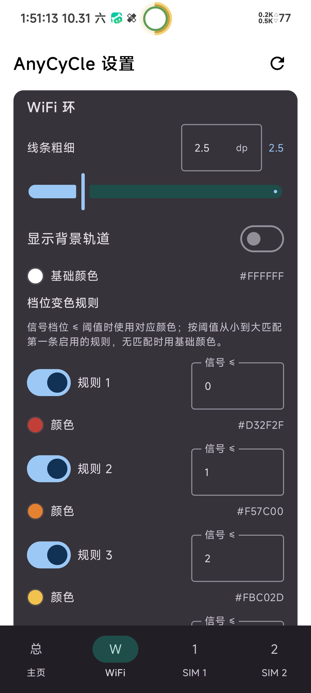

# AnyCyCle

**AnyCyCle** 是一个基于 libxposed API 102 的 LSPosed 模块：它把状态栏信号（SIM1 / SIM2 / WiFi 档位 0–4）画成**套在摄像头挖孔上**的嵌套环形指示器（多环紧贴套环），并按 HyperCeiler 的方式隐藏状态栏对应的原版图标。

- 应用名：AnyCyCle
- 包名：`io.github.z2549.anycycle`
- minSdk 35 / targetSdk 36 / compileSdk 37
- AGP 8.13.1 + Gradle 8.13 + Kotlin 2.2.10
- 许可证：AGPL-3.0-only

## 功能

### 环形信号显示

- **挖孔定位**：环自动套在前置摄像头挖孔上（读取 `DisplayCutout`），圆心/半径自适应，支持挖孔半径微调（±6dp）与水平/垂直偏移；
- **累进制嵌套布局**：最内环内缘贴挖孔边缘，后一环内缘贴前一环外缘（互相紧贴），调整任一环粗细时该环**向外扩展**，不会遮挡摄像头；
- **嵌套顺序可调**：内/中/外三个槽位任选 WiFi / SIM1 / SIM2，默认 WiFi 最内环；
- **逐环颜色与粗细**：每一环的颜色、粗细、背景轨道均可独立配置；
- **数值级档位变色**：每环 5 条规则，信号档位 ≤ 阈值时按规则变色（默认红→绿五档，三环默认色深浅分明便于区分）；
- **环间分割线**：可选在相邻两环之间画一圈细线（宽度 0–3dp、颜色可配）；
- **多彩选色器**：预设色板 + 饱和度/明度面板 + 色相条 + Hex 输入。

### 状态栏图标隐藏

- 按 HyperCeiler 的实现方式，hook `StatusBarIconControllerImpl#setIcon` 将对应 slot 图标置为不可见，并同步 HyperOS 的 `MiuiIconManagerUtils` BLOCK_LIST；
- 覆盖 slot：`wifi` / `demo_wifi` / `mobile` / `demo_mobile` / `no_sim` / **`stacked_mobile`**（HyperOS 双卡叠加信号图标）；
- 隐藏 SIM 环时连带隐藏移动网络类型标识（"5G" 小字，hook `MobileTypeDrawable#measure`，参考 HyperCeiler MobileTypeSingle2Hook）；
- 显示环与图标隐藏联动：选哪环藏哪图标。

### 模块应用

- **四页设置**：主页（总开关 / 显示内容 / 嵌套顺序 / 外观偏移 / 分割线 / 应用功能）+ WiFi / SIM1 / SIM2 三个环详情页；
- **重启系统界面按钮**：顶栏右上角一键 `killall com.android.systemui`（需 root 授权）；
- **配置实时同步**：通过 libxposed 102 RemotePreferences 推送至 SystemUI 进程，即改即生效；
- **开关状态一致**：应用内所有开关乐观更新本地状态，不依赖跨进程回调回读，杜绝偶发的"开关弹回旧值"；
- **配置备份**：导出 / 导入 JSON 配置文件（SAF），一键恢复默认；
- **隐藏桌面图标**：隐藏后可从 LSPosed 管理器重新打开设置页。

## 截图

状态栏效果（双环紧贴挖孔，WiFi 满格 + SIM1 三格；原版信号 / WiFi 图标已隐藏）：


挖孔特写：


| 模块主页 | 环详情页（以 WiFi 为例） |
| :---: | :---: |
|  |  |

## 安装与使用

1. 安装 APK（从 [Releases](../../releases) 下载或自行构建）。
2. 在 **LSPosed 管理器** 中启用 AnyCyCle，作用域仅勾选 **系统界面（com.android.systemui）**。
3. 重启系统界面使 hook 生效：

   ```bash
   adb shell killall com.android.systemui
   ```

4. 打开 AnyCyCle 应用调整环的显示内容、顺序、颜色、粗细与变色阈值，配置会自动同步到状态栏；
5. 部分状态相关设置（如隐藏图标开关）切换后若未立即生效，点右上角按钮重启"系统界面"。

## 构建方法

### 本地构建

要求：JDK 17+（构建脚本以 17 为目标字节码，CI 使用 JDK 21）、Android SDK 37。

```bash
./gradlew assembleDebug    # 调试包
./gradlew assembleRelease  # 发布包
```

产物位于 `app/build/outputs/apk/` 下。

### 签名

本项目使用固定密钥签名，debug 与 release、本地与 CI 均使用同一密钥，保证安装包签名不变、可直接覆盖安装：

- 在项目根目录放置 `keystore.properties`（不进 git）：

  ```properties
  storeFile=keystore/anycycle.jks
  storePassword=你的store密码
  keyAlias=你的alias
  keyPassword=你的key密码
  ```

- 密钥文件放在 `keystore/anycycle.jks`（不进 git）。
- 未配置签名时，release 构建会回退为未签名/debug 签名继续构建，不会失败。

### CI 构建

仓库内置三个 GitHub Actions 工作流：

| 工作流 | 触发 | 作用 |
| --- | --- | --- |
| `build.yml` | push 到 main（忽略纯 md）/ PR | 构建 debug + release APK 并上传 artifact |
| `release.yml` | 推送 `v*` tag | 构建 release APK 并发布 GitHub Release（`AnyCyCle v<tag>`） |
| `pr-review.yml` | PR | Android Lint + reviewdog 行内评论 + 审阅汇总评论 |

CI 通过以下 GitHub Secrets 还原签名（均需 Base64）：

| Secret | 说明 |
| --- | --- |
| `KEYSTORE_BASE64` | `keystore/anycycle.jks` 的 Base64 内容（`base64 -w0 anycycle.jks` 生成） |
| `KEYSTORE_PASSWORD` | keystore 密码 |
| `KEY_ALIAS` | key 别名 |
| `KEY_PASSWORD` | key 密码 |

未配置 Secrets 时，CI 自动回退为无固定签名继续构建，不会导致构建失败。

> 说明：`versionCode` 取自 git commit 数，因此 CI 检出使用 `fetch-depth: 0` 获取完整历史；仓库 Gradle 依赖使用 aliyun 镜像加速，海外 CI 环境亦可正常构建。

`versionCode` 的实现（`CommitCountValueSource`）借鉴自 lsp_CycleBattery。

## 代码来源与致谢

AnyCyCle 的部分架构与实现方式借鉴了以下优秀开源项目，在此致谢：

### 1. 悬浮窗注入架构 —— 借鉴 [imRoxy2222/lsp_CycleBattery](https://github.com/imRoxy2222/lsp_CycleBattery)

- **hook `Instrumentation#callApplicationOnCreate` 获取 SystemUI 上下文**的注入方式；
- **`TYPE_STATUS_BAR_SUB_PANEL` 全屏透明悬浮窗**承载自绘状态栏指示器的窗口方案；
- **纯 Java 自绘 View**（避免 Kotlin 运行时依赖注入 SystemUI 进程出问题）的思路；
- **libxposed API 102 RemotePreferences** 作为模块 App 与 Hook 之间的配置通道；
- 其环形电量 View 的**防崩结构**（异常兜底、资源释放等）被 AnyCyCle 的 `SignalRingView` 沿用。

### 2. 状态栏图标隐藏实现方式 —— 借鉴 [HyperCeiler](https://github.com/Sevtinge/HyperCeiler)（AGPL-3.0）

- 实现方式来自 HyperCeiler 的 **IconsFromSystemManager**：hook `com.android.systemui.statusbar.phone.ui.StatusBarIconControllerImpl#setIcon`，将 `StatusBarIcon.visible` 置为 `false`；
- AnyCyCle 对新旧两条类名路径做了兼容处理；
- slot 名参考其 **SwapWiFiAndMobileNetwork** 中使用的 `wifi` / `demo_wifi` / `mobile` / `demo_mobile` / `no_sim`；
- `stacked_mobile`（HyperOS 双卡叠加信号）为 AnyCyCle 真机诊断后补充。

### 3. 原创部分

AnyCyCle 的以下内容为原创实现：

- `SignalRingView` 环形信号自绘 View 与**挖孔累进制嵌套布局**（内缘贴孔、向外扩展、环间紧贴）；
- 挖孔锚点机制（抵御 MIUI 焦点通知对窗口 DisplayCutout 的动态改写）；
- 信号档位数据源与解析（WiFi RSSI → 0–4 档映射、双卡 TelephonyCallback 绑定）；
- 逐环变色规则引擎（数值级阈值触发变色）；
- 模块设置界面（Compose 四页导航、选色器、配置备份）。

## 许可证

本项目以 **[AGPL-3.0-only](LICENSE)**（GNU Affero 通用公共许可证第 3 版）发布。

选择 AGPL-3.0 的原因：本项目借鉴了 HyperCeiler（AGPL-3.0 许可）的实现方式，衍生实现需遵循同一许可证向下传播。

## 免责声明

- 本项目为个人学习与研究目的开发，与任何官方厂商无关。
- 使用本模块修改系统界面（SystemUI）存在一定风险，可能导致系统界面异常；由此造成的任何损失由使用者自行承担。
- 本项目按"现状"提供，不含任何明示或暗示的担保。

## 版本历史

| 版本 | 主要变更 |
| --- | --- |
| v1.0 | 单环版：WiFi 环 + 挖孔定位 + 档位变色 |
| v1.1 | 多环嵌套重构：内外顺序可调、累进制布局、挖孔中心校正 0.6dp |
| v1.2 | 顺序修复、HyperOS `stacked_mobile` 隐藏、四页 UI、选色器、分割线、备份 |
| v1.2.1 | 5G 网络类型标识联动隐藏；开关状态乐观更新修复 |
